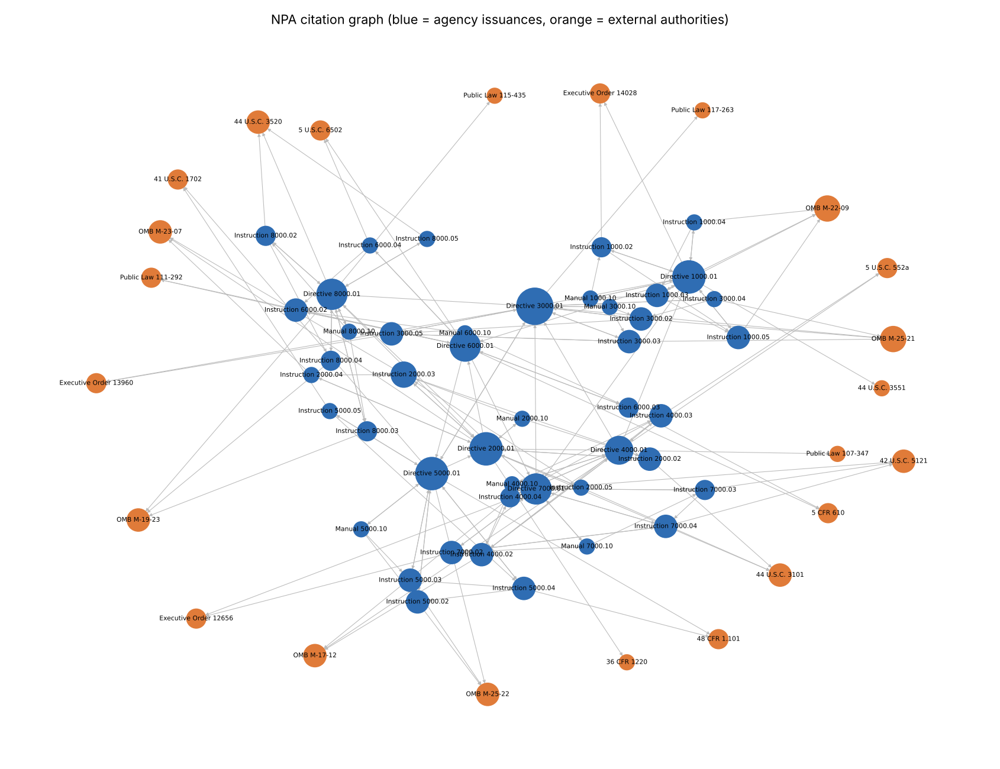

# PolicyLens

**Search, summarize and connect large collections of government policy documents.**

Agencies maintain thousands of directives, instructions and manuals that reference each other and the laws behind them. Finding the rule that answers a question, or every policy that depends on a given statute, is slow manual work. PolicyLens indexes a folder of `.txt`, `.md` or `.pdf` files and gives you:

| Capability | How |
|---|---|
| **Hybrid search** | BM25 keyword scoring (for exact identifiers and jargon) fused with LSA concept search (TF-IDF → SVD), using Reciprocal Rank Fusion |
| **Extractive Q&A** | a query-focused TextRank summary of the top passages, returned with its source documents |
| **Summaries** | TextRank over a document's sentences. Summaries are extractive, so they never contain wording that isn't in the source |
| **Citation graph** | regex extraction of issuances, U.S.C., CFR, Public Laws, OMB memos and Executive Orders into a NetworkX graph, with PageRank influence and "what cites X?" queries |
| **Related documents** | cosine similarity in concept space |
| **Acronym glossary** | mined from definitions such as "Chief AI Officer (CAIO)" |

The project is inspired by the DoD's [GAMECHANGER](https://github.com/dod-advana/gamechanger-ml). PolicyLens is a small, independent, CPU-only implementation of the same idea, using classic NLP and no GPU or hosted model.



## Quick start

```bash
git clone https://github.com/SAADALKINANI/policylens.git
cd policylens
pip install -e ".[pdf,dev]"
pytest
python examples/demo.py
```

```python
from policylens import PolicyLens

lens = PolicyLens.from_directory("data/sample_corpus")   # or a folder of your own PDFs

lens.answer("how quickly must a security incident be reported")
# {'answer': 'Security incidents must be reported to the Security Operations Center (SOC)
#             within one hour of discovery. ...',
#  'sources': ['Directive 1000.01', 'Manual 1000.10', 'Instruction 1000.04']}

lens.cited_by("44 U.S.C. 3101")          # ['Directive 2000.01', 'Instruction 2000.02', ...]
lens.most_influential(5)                  # PageRank over the citation graph
lens.similar("Instruction 3000.03")       # related policies
lens.acronym("CAIO")                      # 'Chief AI Officer'
```

## Command line

```bash
policylens sample-corpus --out data/sample_corpus
policylens index data/sample_corpus --out npa.idx
policylens search "telework agreement" --index npa.idx
policylens ask "when can records be destroyed" --index npa.idx
policylens summarize "Directive 3000.01" --index npa.idx
policylens graph --index npa.idx --top 10 --export graph.graphml   # open in Gephi
policylens graph --index npa.idx --doc "Directive 1000.01"
policylens acronyms --index npa.idx
```

## Sample corpus

`data/sample_corpus/` holds 45 documents from the **National Public Administration (NPA)**, a fictional agency generated by `policylens.synthetic`. The documents follow the structure of real federal issuances: purpose, applicability, policy, responsibilities, procedures and references. They cover eight program areas: cybersecurity, records, AI governance, privacy, acquisition, telework, continuity and data management. They cite each other and **real** external authorities, such as 44 U.S.C. 3101 and OMB M-25-21. **None of the NPA text is actual government policy.**

To use real documents, drop PDFs into a folder and run `PolicyLens.from_directory("my_pdfs")`. If your numbering scheme differs, pass your own regexes to `ReferenceExtractor`.

## How it works

```
files ──► clean (strip headings/front-matter) ──► 3-sentence overlapping passages
                                                     │
                     ┌───────────────────────────────┼───────────────────────────────┐
                     ▼                               ▼                               ▼
              BM25 inverted index         TF-IDF (1-2 grams) → SVD          regex references
                     │                       (LSA concepts)                         │
                     └──────── Reciprocal Rank Fusion ┘                     citation DiGraph
                                       │                                   PageRank / neighbours
                              top passages ──► query-biased TextRank ──► answer + sources
```

Design choices:

- **Extractive answers only.** For policy and legal text, a wrong paraphrase can do real harm. Every sentence PolicyLens returns appears in a source document, and the source ids come with it.
- **Hybrid retrieval.** Keyword search alone misses "remote work" when the policy says "telework". Concept search alone blurs exact identifiers such as "8510.01". Fusing their ranks gets the benefit of both without having to tune the two score scales against each other.
- **Light stemming** (report/reported/reporting) with no external NLP downloads, so it runs in locked-down government environments.

## Limits and next steps

- LSA is a 1990s-era concept model. A natural upgrade is to swap `LSA` for sentence-transformer embeddings when a GPU or approved model is available. The `HybridIndex` interface stays the same.
- PDF extraction relies on the PDF having a text layer. Scanned documents need OCR first.
- Pickled indexes should only be loaded from sources you trust.

## License

Apache 2.0
